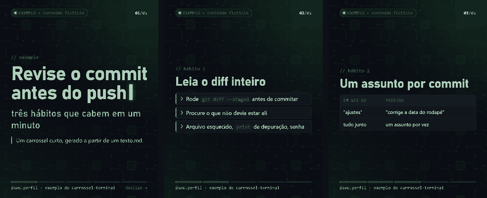

# carrossel-terminal

Gerador de carrosséis para o Instagram com cara de terminal: você escreve o
post num `texto.md`, um slide por bloco, e sai um PNG 1080×1350 (4:5) por
slide. Antes de publicar, um conferidor abre cada slide no Chrome sem tela e
barra o que se vê errado no celular: letra pequena, contraste baixo, texto
cortado, link morto. O mesmo post vira Reel 1080×1920 com trilha sintetizada.



> **Estado:** versão 0.1.0. Usado de verdade nos posts da conta
> [@peterwk.dev](https://www.instagram.com/peterwk.dev/), feito e testado no
> Windows 11 com Python 3.12. macOS e Linux devem funcionar (o navegador é
> procurado nos lugares comuns), mas ainda não foram testados. O formato do
> `texto.md` pode mudar antes da 1.0. O post de exemplo é fictício.

## Instalar

Precisa de Python 3.10 ou mais novo e de um navegador da família Chrome
(Chrome, Chromium ou Edge), que gera as imagens sem abrir janela. Para o
Reel, também do [ffmpeg](https://ffmpeg.org/) no PATH.

```bash
git clone https://github.com/peterwkdev-creator/carrossel-terminal && cd carrossel-terminal && python -m pip install -r requirements.txt
```

Se o navegador não for achado, aponte o caminho dele na variável `CHROME`.

## Uso

```bash
python gerar.py exemplos/post-exemplo                # texto.md -> html/ e png/ (1080x1350)
python conferir.py exemplos/post-exemplo --publicar  # APROVADO ou a lista de defeitos
python reel.py exemplos/post-exemplo                 # reel/post-exemplo-reel.mp4 (1080x1920)
```

O `texto.md` do exemplo, resumido:

```text
selo: EXEMPLO · conteúdo fictício
rodape: @seu.perfil · exemplo do carrossel-terminal

--- slide capa
// exemplo
# Revise o commit antes do push
## três hábitos que cabem em um minuto

--- slide
// hábito 1
# Leia o diff inteiro
- Rode `git diff --staged` antes de commitar
> nota de conferência: fica no texto, não vai para a imagem
```

Também dá para usar as funções em Python, sem navegador, para gerar o HTML:

```python
from pathlib import Path
from gerar import ler, pagina

post = Path("exemplos/post-exemplo")
cab, slides = ler(post)
print(cab["selo"])                   # EXEMPLO · conteúdo fictício
print([s["tipo"] for s in slides])   # ['capa', 'texto', 'texto', 'texto', 'texto']
html = pagina(cab, slides[0], 1, len(slides), post)
print("<h1>Revise o commit antes do push</h1>" in html)   # True
```

## Por quê

Carrossel feito em editor visual não tem diff: o texto revisado e a imagem
publicada se separam, e um erro de número ou de link só aparece depois de
postado. Aqui o post é texto versionado, o visual é um CSS só, e a conferência
é medida no slide renderizado, não no olho. A nota de conferência (de onde
veio cada número) mora ao lado do texto, na linha com `>`, e não vai para a
imagem.

## O que cobre

| Script | O que faz |
|---|---|
| `gerar.py` | `texto.md` → `html/slide-NN.html` → `png/slide-NN.png`; `--sem-png` para só o HTML |
| `conferir.py` | barra letra abaixo de 30 px, contraste abaixo de 4,5:1 (WCAG AA), texto fora da tela, conteúdo que transborda, imagem que não carregou ou ampliada demais, link escrito no slide que não dá 200; com `--publicar`, também captura pendente e campo `PREENCHER` |
| `reel.py` | o carrossel em Reel 9:16, com tempo de leitura por slide e trilha sintetizada no próprio script (sem direito autoral de terceiros), normalizada a -16 LUFS |
| `reel_narrado.py` | o Reel com voz sintética e legenda queimada (opcional; ver abaixo) |
| `amostras.py` | o mesmo post em cada tema e formato, conferido, numa imagem de comparação |
| `provas.py` | as duas provas do conferidor: pega o defeito plantado, zero falso positivo no limpo |

Formato do `texto.md` (está também no topo do `gerar.py`):

| Linha | Vira |
|---|---|
| `selo:`, `rodape:`, `tema:`, `formato:` (antes do 1º slide) | cabeçalho, rodapé, tema (`temas/minimo.css`, `temas/janela.css`) e formato (`4:5` ou `3:4`) |
| `--- slide capa`, `--- slide`, `--- slide fontes` | começo de um slide e o tipo dele |
| `# título`, `## subtítulo`, `- item`, `\| a \| b \|` | título, subtítulo, lista, tabela (1ª linha é o cabeçalho) |
| `// rótulo` (`// !` sai em âmbar) | rótulo acima do título |
| `[imagem: capturas/x.png \| rótulo]` | captura de tela numa janela de terminal |
| `[captura: o que capturar]` | lugar marcado de captura pendente (o `--publicar` barra) |
| `> nota` | nota de conferência: não vai para a imagem |
| `**destaque**`, `` `código` ``, `!!alerta!!` | em linha |

**Reel narrado (opcional).** O `reel_narrado.py` lê `<post>/narracao.txt`
(linhas `slide | frase`) e chama o `narrar.py` de um TTS em português, o
repositório [`tts-ptbr`](https://github.com/peterwkdev-creator/tts-ptbr) do mesmo autor, que
devolve a voz e o tempo de cada frase. Sem ele, todo o resto funciona. A pasta
do TTS vem de `--tts <pasta>`, da variável `CARROSSEL_TTS` ou, por padrão, de
`../tts-ptbr` (um clone ao lado deste); o Python dele, de `CARROSSEL_TTS_PYTHON` ou do `.venv-kokoro`
dentro da pasta.

## Como é testado

```bash
python -m unittest
```

- `tests/test_gerar.py`: o exemplo vira 5 slides em HTML, com a nota de
  conferência fora da imagem (sem navegador).
- `tests/test_conferidor.py`: o conferidor reprova o `provas/plantado/` citando
  cada um dos 6 defeitos plantados e aprova o `provas/limpo/` e o exemplo.
  Precisa do navegador (sem ele, os testes são pulados) e de rede (o link
  plantado tem de dar 404).
- `tests/test_readme.py`: os blocos Python deste README rodam como estão.

`python provas.py` roda as duas provas também nos posts que estiverem na
pasta de cima (`../post-*`), como no uso real.

## Mais exemplos

O passo a passo do exemplo, do texto ao Reel narrado, está em
[exemplos/README.md](exemplos/README.md). Para trocar o visual, ponha
`tema: janela` ou `formato: 3:4` no topo do `texto.md`; para comparar todos de
uma vez, `python amostras.py exemplos/post-exemplo`.

## Limites

- O conferidor não lê texto dentro de imagem (captura de tela) nem mede
  contraste sobre fundo com imagem ou gradiente: ele diz quantos ficaram de
  fora, para você olhar.
- Link atrás de desafio anti-robô (Cloudflare) não dá para conferir sem
  navegador: vira aviso, e o `--publicar` barra até você conferir.
- O Reel assume slide 4:5. A legenda do Reel narrado usa a fonte Segoe UI;
  fora do Windows, o ffmpeg troca por outra.
- Os scripts usam um perfil só do Chrome sem tela: rode um de cada vez. Dois
  ao mesmo tempo disputam o perfil, e o conferidor acusa "instrumento cego".
- Ele confere a forma, não o conteúdo: número certo e fonte citada continuam
  sendo trabalho de quem escreve.

## Pastas

```text
gerar.py, conferir.py, auditoria.js   texto -> HTML -> PNG, e o conferidor
reel.py, reel_narrado.py              carrossel -> Reel (com ou sem narração)
amostras.py, provas.py                comparação de temas e as provas do conferidor
modelo.css, temas/                    o visual (cores e tamanhos só aqui)
provas/plantado/, provas/limpo/       entrada das duas provas
exemplos/post-exemplo/                o post de exemplo (texto.md e narracao.txt)
docs/                                 a imagem deste README
tests/                                python -m unittest
```

`html/`, `png/` e `reel/` dentro de cada post são gerados e ficam fora do git.

## Contribuir

Issue e pull request são bem-vindos: veja o [CONTRIBUTING.md](CONTRIBUTING.md)
e o [código de conduta](CODE_OF_CONDUCT.md). Falha de segurança vai pelo aviso
privado ([SECURITY.md](SECURITY.md)).

<!-- outros-projetos:inicio -->
## Outros projetos

| Projeto | Para que serve |
|---|---|
| [numeros-publicos](https://github.com/peterwkdev-creator/numeros-publicos) · [site](https://www.numerospublicos.com.br) | Dados abertos de cada município brasileiro (IBGE, Tesouro Nacional, INEP), conferidos contra a fonte, uma página por município |
| [simples-nacional-br](https://github.com/peterwkdev-creator/simples-nacional-br) · [site](https://peterwkdev-creator.github.io/simples-nacional-br/) | Simples Nacional conferido contra a LC 123 e a LC 214: alíquota, DAS, repartição, Fator R e CNAE |
| [linguagem-simples-br](https://github.com/peterwkdev-creator/linguagem-simples-br) · [site](https://peterwkdev-creator.github.io/linguagem-simples-br/) | Verificador aberto da Lei 15.263/2025 (Linguagem Simples): confere um texto contra o art. 5º |
| [claude-context-cost](https://github.com/peterwkdev-creator/claude-context-cost) · [site](https://peterwkdev-creator.github.io/claude-context-cost/) | Quanto cada fonte (CLAUDE.md, regras, skills, memória) custa no contexto de uma sessão do Claude Code |
| [vra-anac](https://github.com/peterwkdev-creator/vra-anac) | Pontualidade dos voos domésticos do Brasil pelo VRA da ANAC |
| [tts-ptbr](https://github.com/peterwkdev-creator/tts-ptbr) | Voz sintética em português com modelos abertos (Kokoro e Piper), medida pelo Whisper |
| [numerasheets-site](https://github.com/peterwkdev-creator/numerasheets-site) · [site](https://numerasheets.com) | Vitrine da loja NumeraSheets: modelos de planilha e calculadoras grátis |
<!-- outros-projetos:fim -->

## Licença

[MIT](LICENSE).
